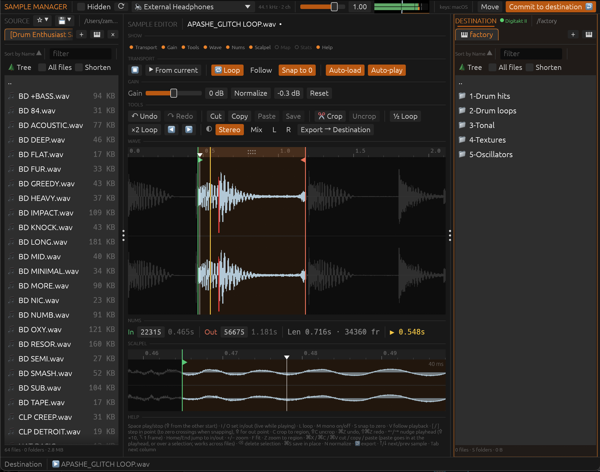
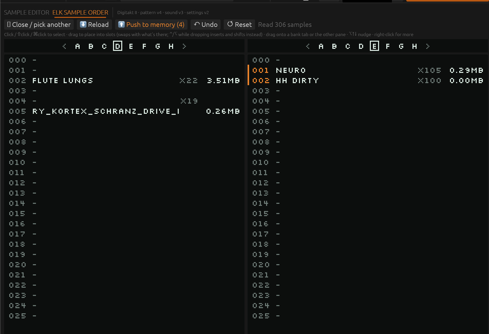

# Sample Manager

A desktop app for organising audio samples and moving them onto an
Elektron Digitakt.

- **File browser** with list and tree views, an audio-only filter,
  favourites, cut/copy/paste, duplicate removal and reveal in Finder.
- **Sample editor** with playback, in/out points, looping, trim, gain,
  normalise, loudness and spectrum stats, and export.
- **Digitakt +Drive access over USB MIDI**: browse, create folders, rename,
  move, delete (to `/trash`, so mistakes can be undone), and transfer
  samples both ways.

Built in Rust with [egui](https://github.com/emilk/egui).



## How it works

The window is a sandwich: a **source** browser on the left, a
**destination** browser on the right, and a **sample editor** in between.
The idea is to dig through a large sample library quickly, cut out just the
bits you want, make them mono if needed, and drop them into a target
folder. That target can be another local folder or an Elektron machine's
+Drive.

**Source (left).** Where you browse your library. Tabs at the top hold
bookmarked folders (★ adds favourites, `+Drive` opens a connected Elektron
device). Sort by name, size, date or kind, type to filter, switch to a tree
view, or tick *All files* to list every file below the current folder.
Selecting a file loads it into the editor (and plays it, with *Auto-play*
on), so you can step through hundreds of samples with the arrow keys.

**Sample editor (centre).** Trim the loaded sample down to the part you
want. The main waveform is always shown: the green and red markers are
the in and out points, and the shaded part between them is the selection.
The *Show* row toggles the other panels on and off:

- **Transport**: play/stop, loop, follow playhead, snap to zero crossings,
  auto-load and auto-play.
- **Gain**: gain and normalise (**N**). In a kit it changes only the
  selected audio. Gain above 0 dB goes through a soft limiter that bends
  peaks over instead of chopping them; the wave and stats show what was
  limited and what still clips.
- **Tools**: undo/redo, cut/copy/paste, save, crop/uncrop to the selection,
  halve or double the loop, and the channel mode: keep *Stereo*, *Mix* to
  mono, or keep only *L* or *R*. Mono applies to playback, stats, save
  and export alike (**M** toggles it).
- **Nums**: in, out, length and playhead readout under the wave.
- **Scalpel**: a 40 ms close-up around the playhead for precise cuts.
- **Map**: the whole file at a glance; click to jump.
- **Stats**: levels, DC offset, mono-fold check, a phase meter, loudness
  (EBU R128: integrated, short-term, momentary, range, true peak) and a
  spectrum analyser.
- **Trim** (kits only): see below.
- **Help**: the keyboard shortcut list.

The **pitch fader** in the top bar speeds playback up or down (pitch and
tempo together, ±50 %) for previewing. Shift-drag for fine moves,
double-click to recentre. It never changes the file, and resets on each
new sample.

*Export → Destination* writes the selection, with the chosen channel mode,
into the folder open on the right. If the name is taken you can pick
another or overwrite.

**Destination (right).** The target folder, with the same tabs and
browsing tools as the source. It can be a local folder or the +Drive of a
Digitakt (or another Elektron sampler) over USB.

**Commit to destination** (top right) copies the source selection into the
active destination tab. If a single file is open in the editor, it is
written as you hear it: trimmed, with gain and mono settings applied, and
the original stays untouched. *Move* does the same but moves the files.

**Top bar.** Audio output device and its sample rate, and a toggle for
showing hidden files.

### Slice kits

A slice kit is a second file kept next to the sample in the editor. It
collects the bits you cut out of many samples, one after another, into a
single file (handy for chains of drum hits).

- Select part of a sample and press **K** (or click the arrow button) to
  add it to the end of the kit, as you hear it (trimmed, gain and mono
  applied).
- The first time, you're asked to name the new kit. It's created in the
  active destination tab when that's a local folder. To keep adding to a
  file you already have, open it and choose *Use as kit*.
- Press **B** to switch the editor between the sample and the kit. Moving
  to another file in the browser always brings you back to the sample.
- Press **⌘S** while showing the kit to save it. The kit stays open between
  launches, and quitting asks about unsaved kit changes.
- Each slice gets a **marker**, saved as a WAV cue point. Click near a
  marker to park the playhead on it; double-click to select one slice.
  **G** inserts 100 ms of silence before the playhead.
- Several kits can be open at once. The kit tab picks the one **K** adds
  to, its **×** closes it, and right-click a file → *Load as kit* opens
  another. *Export and close* writes a kit and closes it in one step.
- **⌘Z** while browsing takes back the last slice **K** added (if nothing
  happened since); **⇧⌘Z** puts it back.

**Trim.** Turn on the *Trim* panel to free up sample memory: it cuts each
slice's tail where the sound drops below a threshold and fades out slices
that stop while still sounding. What will go is shaded on the wave and the
panel shows the time saved before you apply it; **⌘Z** undoes. All fades
share one length and curve: drag the fade handle on the wave (↔ length,
↕ curve), **⌥-drag** to shape just one, double-click to reset.

**Grid kits.** The Digitakt 1 can only slice a file into equal parts, so a
kit can be laid out on 4, 8 or 16 equal slots: each slice starts its own
slot, padded with silence to the longest one, so every slice plays from
its real start on the device.

- Pick the layout in the new-kit dialog or with the switch next to the
  Kit tab: *Free*, *Auto*, 4, 8 or 16. *Auto* starts at 4 and grows to 8,
  then 16, as you add slices, and shrinks again when you cut them.
- **K** fills the next free slot. Cuts, pastes and inserted silence snap
  everything back onto the grid; if the slices no longer fit, the kit
  goes back to free layout instead of losing anything.
- Switching to *Free* keeps the slices where they are and drops the empty
  slots and padding left at the end.
- Exported grid kits get the slot count in their name (`[8] drums.wav`).
  A file named like that, or one whose markers split it evenly, opens as
  a grid kit.
- Samples you've taken a slice from get the same check mark in the
  browser as files committed to the destination, so you can see what's
  already in the kit.

### Elek Sample Order

Click **Elek Sample Order** next to the editor title to rearrange the sample
pool of the project loaded on a Digitakt or Digitakt II. Drag a slot onto
any other (in any bank) to swap them, or select several and move them with
**⌥↑ / ⌥↓**. **Push to memory** writes the new order into the project in
the device's memory, updating patterns, kits and sounds to match. Only the
parts that changed are sent. Saved projects on the +Drive are never
written; save the project on the device to keep the result.

Two panes show two banks side by side; drag onto a bank tab or into the
other pane to move samples between banks. Hold **⌃** or **⌥** while
dropping to insert and shift the following slots instead of swapping.
The `×N` column shows how many times the project uses each sample (kit
tracks, sample locks and sounds).

Click a slot, or move onto it with ↑/↓, to hear it. A sample without a
local copy is fetched into a preview cache first; *Cache …* fetches the
whole pool in the background. Drop audio files onto empty slots to add
them to the project: they're uploaded into the +Drive folder open in a
file tab (files already on the +Drive are just linked).



> **Use at your own risk.** Push to memory rewrites the project that is
> currently loaded on the device. The saved copy on the +Drive is left
> alone, but the reverse-engineered project format may still have gaps.
> **Save your project on the Digitakt before pushing**, so you can reload
> it if anything comes out wrong, and only save over it once you've
> checked the result.

### Drag and drop

- Drag files and folders between panes, onto folder rows, or onto a tab.
  Within the same drive a drop moves; hold **⌥** or **Ctrl** to copy
  instead (the cursor shows a copy badge). Drops between the computer and
  the Digitakt always copy.
- Drag files out to **Finder / Explorer**, or drag them in from there
  (dragging in always copies).
- Drop folders onto a tab bar to open each one as a new tab.

### Tabs and file operations

- Right-click a tab to **move or copy it to the other pane**. A long tab
  row scrolls sideways.
- Click an already-selected item again to rename it, Finder style.
- *New folder with selection* puts the selected items into a new folder
  and opens rename straight away.
- When a transfer hits an existing folder, *Merge* adds new files and skips
  identical ones.
- The app remembers which local file each device file was uploaded from
  or downloaded to, and follows it through renames and moves on the
  device. While the local file is unchanged, the device file opens and
  plays straight from it. Right-click for *Open local copy in editor*,
  *Show local copy in other pane* or *Show on device*.
- **Send to device as…** uploads an edited sample as a new file next to
  the device file it came from, never over it.
- Transfers to and from the Digitakt run in a queue. Creating and renaming
  folders jumps ahead of queued file transfers, so the folder is ready
  before the files arrive.

## Building

Install Rust from <https://rustup.rs>, then:

```bash
./build.sh run
```

`./build.sh` alone makes a release build at `target/release/sample_manager`.
The script's header lists the other options (`bundle`, `windows`, `dev`,
`test`, `clean`).

**Windows from a Mac.** `./build.sh windows` cross-compiles a 64-bit `.exe`
into `target/bundle/Sample Manager Windows.zip`. It needs
[cargo-xwin](https://github.com/rust-cross/cargo-xwin)
(`cargo install cargo-xwin --locked`). The first build downloads Microsoft's
C runtime and Windows SDK into cargo-xwin's cache, which means accepting
Microsoft's license for them.

## Acknowledgements

The Digitakt support would not exist without **Mark Lentczner's
[elk-herd](https://github.com/mzero/elk-herd)**. Mark worked out Elektron's
undocumented SysEx file-transfer protocol and published his work as open
source. Our command codes, 7-bit encoding, transfer chunk size and the
`/trash` convention all come from studying his project. Thank you, Mark.¹

---

¹ **Licensing note.** Sample Manager has its own Rust implementation of the
protocol. It contains no elk-herd source code (elk-herd is written in Elm).
What we took from elk-herd is knowledge of how the protocol works, not its
code.

Sample Manager uses these third-party Rust crates, each under its own
licence: `eframe`/`egui` (UI), `cpal` (audio output), `symphonia`
(decoding), `hound` (WAV writing), `midir` (MIDI), `drag` and `mouse_position` (drag and drop with
Finder / Explorer), `serde`, `trash` and
`walkdir`. Almost all of the dependency tree is MIT and/or Apache-2.0
licensed. Exceptions: `symphonia` is MPL-2.0 (file-level copyleft; we use
it unmodified), and egui's bundled default fonts are under the SIL Open Font
License and the Ubuntu Font Licence.

The device-screen pixel font is **[Dogica Pixel](https://rmocci.itch.io/dogica)
by Roberto Mocci** (2020), used under the SIL Open Font License 1.1 (see
[`assets/dogicapixel-OFL.txt`](assets/dogicapixel-OFL.txt)). It stays crisp
and readable across the sizes the Elektron screens need. Thank you, Roberto.
Run `cargo metadata` or
[`cargo-about`](https://github.com/EmbarkStudios/cargo-about) for the full
list. No third-party file-browser library is used; the file browser is
written from scratch on top of `walkdir` and `trash`.

Sample Manager itself is released under the [MIT License](LICENSE).
