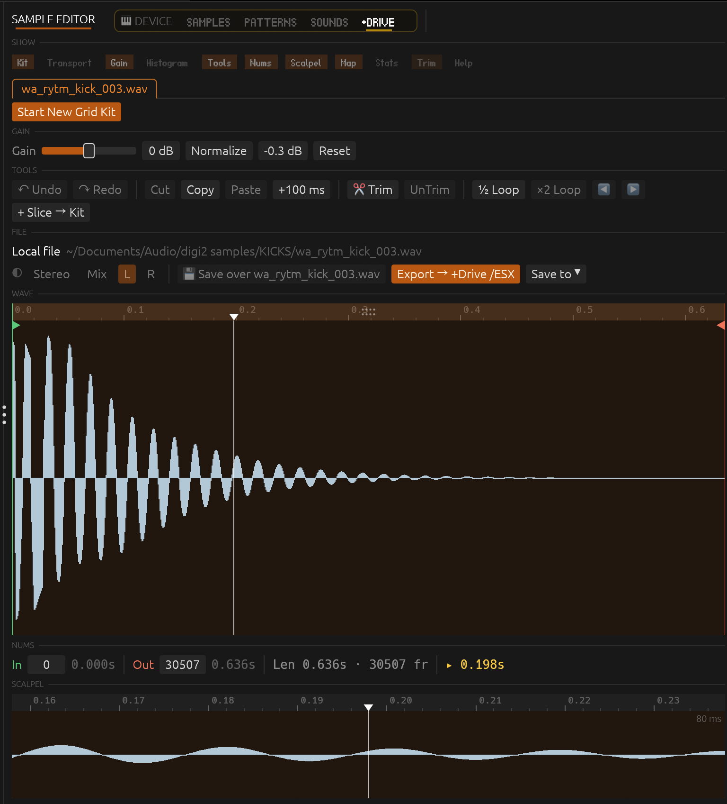
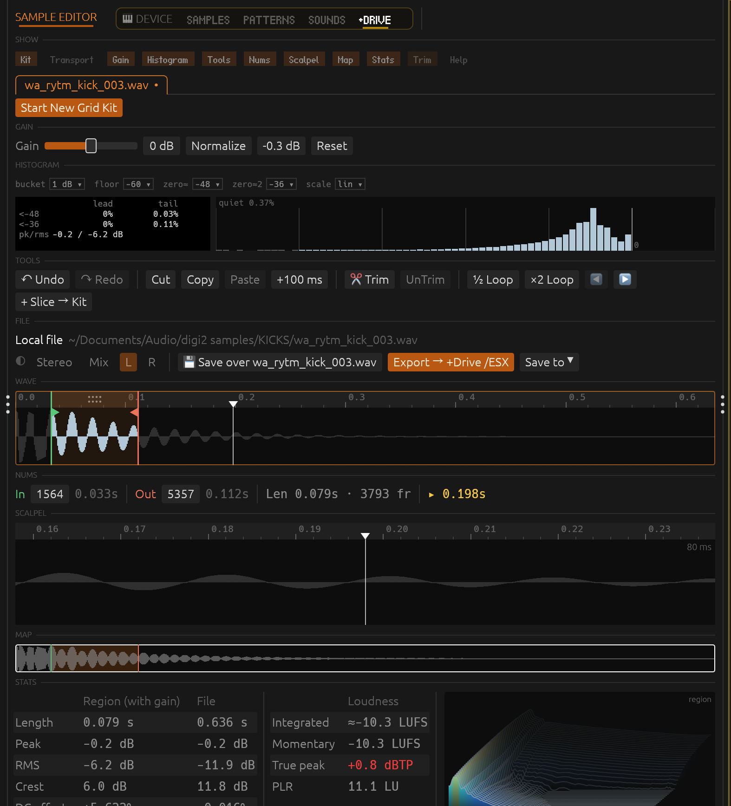
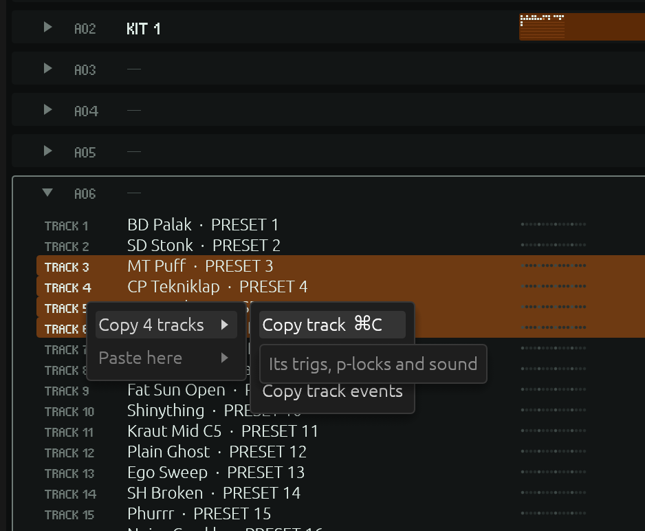
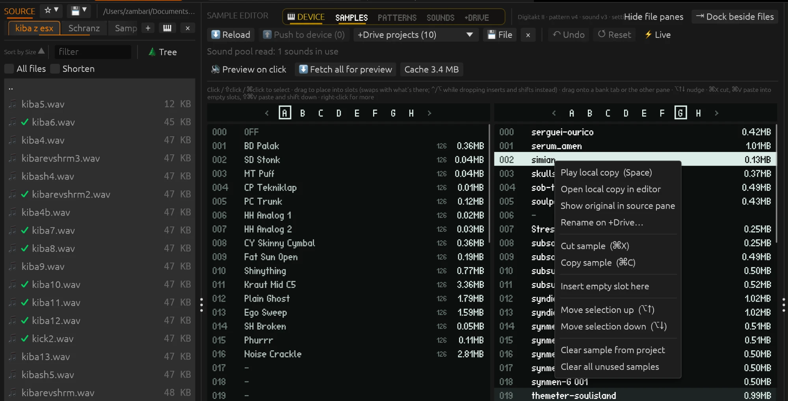

# Sample Manager

A desktop app for digging through a sample library, cutting out the good
bits, and getting them onto an Elektron Digitakt, then tidying up the
project on the device without menu-diving on its screen.





The sample editor with its everyday panels (left) and with every panel switched on (right).</sub></p>

- **File browser** with list and tree views, an audio-only filter,
  favourites, cut/copy/paste, duplicate removal and reveal in Finder.
- **Sample editor** with playback, in/out points, a scalpel close-up,
  looping, trim, gain with a soft limiter, normalise, mono folding,
  loudness, histogram and spectrum stats, and export straight to a folder,
  the +Drive or a pool slot.
- **Slice kits**: collect slices from many samples into one file, free-form
  or on an equal 4/8/16 grid for the Digitakt 1, with automatic tail
  trimming and fades, or a free slice collection for arbitrary lenght slices. Every slice remembers where it came from.
- **Digitakt +Drive access over USB MIDI**: browse, create folders, rename,
  move, delete (to `/trash`, so mistakes can be undone), and transfer
  samples both ways.
- **Device view** for the project loaded on a Digitakt or Digitakt II:
  reorder and clean up the sample pool, move, copy and rename patterns,
  copy tracks and sounds between patterns, edit the sound pool, preview
  on-device samples from a local cache, watch sample memory, and back up
  or restore projects with their samples.


## How it works

The window is a sandwich: a **source** browser on the left, a
**destination** browser on the right, and a **sample editor** in between.
The idea is to dig through a large sample library quickly, cut out just the
bits you want, make them mono if needed, and drop them into a target
folder. That target can be another local folder or an Elektron machine's +Drive.





**Source (left).** Where you browse your library. Tabs at the top hold
bookmarked folders (★ adds favourites, `+Drive` opens a connected Elektron
device). Sort by name, size, date or kind, type to filter, switch to a tree
view, or tick *All files* to list every file below the current folder.
Selecting a file loads it into the editor (and plays it, with *Auto-play*
on), so you can step through hundreds of samples with the arrow keys.


**Destination (right).** A switch at the top picks what the right column
shows: **Files** (local folders, with the same tabs and browsing tools as
the source), **Sample pool** (the slots of the project loaded on the
device) or **+Drive** (the device's storage over USB). The **+Drive** tab
next to Samples / Patterns in the Device group does the same. Commit and
drops land in Files or the +Drive, whichever was shown last.


**Sample editor (centre).** Trim the loaded sample down to the part you
want. The main waveform is always shown: the green and red markers are
the in and out points, and the shaded part between them is the selection.
The *Show* row toggles the other panels on and off:

- **Transport**: play/stop, loop, follow playhead, snap to zero crossings,
  auto-load and auto-play.
- **Gain**: gain and normalise (**N**). In a kit it changes only the
  selected audio. Gain above 0 dB goes through a soft limiter that bends
  peaks over instead of chopping them; the wave and stats show what was
  limited and what still clips.
- **Tools**: undo/redo, cut/copy/paste, save, crop/uncrop to the selection,
  halve or double the loop, and the channel mode: keep *Stereo*, *Mix* to
  mono, or keep only *L* or *R*. Mono applies to playback, stats, save
  and export alike (**M** toggles it).
- **Nums**: in, out, length and playhead readout under the wave.
- **Scalpel**: a 40 ms close-up around the playhead for precise cuts.
- **Map**: the whole file at a glance; click to jump.
- **Stats**: levels, DC offset, mono-fold check, a phase meter, loudness
  (EBU R128: integrated, short-term, momentary, range, true peak) and a
  spectrum analyser.
- **Trim** (kits only): see below.
- **Help**: the keyboard shortcut list.

The **pitch fader** in the top bar speeds playback up or down (pitch and
tempo together, ±50 %) for previewing. Shift-drag for fine moves,
double-click to recentre. It never changes the file, and resets on each
new sample.


<p align="center">
  
  
</p>
<p align="center"><sub>


**Saving.** The File row has three controls, and each names where it writes:

- **Save over *file*** (⌘S) writes what you hear back over the one thing the
  open sample belongs to. For a sample opened from a pool slot that is the
  slot (**⬆ Save → slot 012**: uploaded next to the +Drive original, put in
  the slot, pushed). For a kit it is the kit's own file, once it has one;
  until then it reads *Save (export first)*. A kit never saves over a sample
  its slices came from, even when it was started from one.
- **Export → …** (↩) writes the selection, with the chosen channel mode, as
  a new file into the folder open on the right. If the name is taken you
  can pick another or overwrite. The button names the target when it isn't
  a local folder: **Export → +Drive /samples/…** for a destination tab on
  the device, **Export → slot 012** for a sample opened from a pool slot
  (same as its Save).
- **Save to ⏷** lists every other place: over the local original a device
  copy came from, into the slot selected in the sample pool (empty, or
  replacing what's there after a question), into the first empty slot, or
  as a new file next to its device original on the +Drive.
- With a kit showing, **Export and close** is the highlighted button (the
  usual way to finish a kit); plain **Export kit** keeps it open. Save to ⏷
  has both, plus the pool slots: the whole kit goes into a slot as one
  sample, and the kit stays as it is in the editor.


**Top bar.** Audio output device and its sample rate, and a toggle for
showing hidden files.

**Trim.** Turn on the *Trim* panel to free up sample memory: it cuts each
slice's tail where the sound drops below a threshold and fades out slices
that stop while still sounding. What will go is shaded on the wave and the
panel shows the time saved before you apply it; **⌘Z** undoes. All fades
share one length and curve: drag the fade handle on the wave (↔ length,
↕ curve), **⌥-drag** to shape just one, double-click to reset.

**Grid kits.** The Digitakt 1 can only slice a file into equal parts, so a
kit can be laid out on 4, 8 or 16 equal slots: each slice starts its own
slot, padded with silence to the longest one, so every slice plays from
its real start on the device.

- Pick the layout in the new-kit dialog or with the switch next to the
  Kit tab: *Free*, *Auto*, 4, 8 or 16. *Auto* starts at 4 and grows to 8,
  then 16, as you add slices, and shrinks again when you cut them.
- **K** fills the next free slot. Cuts, pastes and inserted silence snap
  everything back onto the grid; if the slices no longer fit, the kit
  goes back to free layout instead of losing anything.
- Switching to *Free* keeps the slices where they are and drops the empty
  slots and padding left at the end.
- Exported grid kits get the slot count in their name (`[8] drums.wav`).
  A file named like that, or one whose markers split it evenly, opens as
  a grid kit.
- Samples you've taken a slice from get the same check mark in the
  browser as files committed to the destination, so you can see what's
  already in the kit.

### Elektron device view

Click **Device** next to the editor title to work on the project loaded on
a Digitakt or Digitakt II, in place of the editor. Its pages are
**Samples**, **Patterns**, **Presets** and **Sounds**, followed by **+Drive**.
*Load* reads whatever project is open on the
device now (load another one on the device with PROJECT › LOAD first).
Patterns arrive one by one, folded-out banks first; a bank can be edited
as soon as all of it is in, and **Stop** ends a read early, keeping the
banks that finished.

Switching device pages prioritizes the data that page needs after the
current request finishes. Preset banks, listings and preset details load
between project read requests, while the remaining patterns continue in
the background. +Drive browsing stays responsive during project reads too.

Changes stay in the app until you **Push to device**, which writes them
into the project in the device's memory, updating patterns, kits and
sounds to match, then reads it back to check. Only the parts that changed
are sent. Saved projects on the +Drive are never written; save the
project on the device (PROJECT › SAVE) to keep the result. **⌘Z** undoes
an edit, and *Read again* goes back to what's on the device. The app
notices when the device is plugged in or out and reconnects on its own.


#### Samples: reorder and clean up the pool

- Drag a slot onto any other (in any bank) to swap them, or select several
  and move them with **⌥↑ / ⌥↓**. Hold **⌃** or **⌥** while dropping to
  insert and shift the following slots instead of swapping.
- Two panes show two banks side by side; drag onto a bank tab or into the
  other pane to move samples between banks. **⇥ Dock beside files** puts
  the pool in the right column instead, next to the editor and files.
- The `×N` column shows how many times the project uses each sample (kit
  tracks, sample locks and sounds), and the pool shows how many are unused.
- **Clear** (⌫) empties a slot; *Clear all unused samples* empties every
  slot nothing points at. The files stay on the +Drive. Clearing a sample
  that is still used asks first.
- Drop audio files onto empty slots to add them to the project: they're
  uploaded into the +Drive folder open in a file tab (files already on the
  +Drive are just linked).
- Right-click a slot to play it, open it in the editor, find its local
  original, rename it on the +Drive, or cut, copy and paste samples
  between slots. A bar under the panes shows how much sample memory the
  project uses and how much that changed since it was read.


#### Patterns: organise and rename (experimental)

- **Move** patterns by dragging (swaps with what's there; hold **⌥** while
  dropping to copy), or **copy and paste** them (⌘C / ⌘V), within a bank or
  between banks. **Clear** (⌫) empties a pattern. Songs that refer to a
  moved pattern aren't updated yet.
- **Pack bank** moves a bank's used patterns to the front, in order.
- **Rename** a pattern with ⏎ or a double-click; this sets both the
  pattern name and its kit name. With several selected, *Rename all* names
  them from a template: `{n}` counts 1, 2, 3…, `{slot}` is A01…, `{name}`
  keeps the current name (e.g. `VERSE {n}`). A preview shows the result.
- *Fold all* / *Open all banks* and *Hide empty* keep long projects
  manageable.
- **Fold out a pattern** to see its tracks, their sounds and step dots.
  Select tracks and **copy and paste** them into other patterns: the whole
  track (trigs, p-locks and sound), just its events, or just its sound.
  The app asks before a paste would overwrite trigs.

#### Presets: saved sounds on +Drive

The **Presets** page has two independent bank browsers, with bank switches,
a name filter and **Hide empty**. Both lists use the full pane height.
Use **click / ⇧click / ⌘click** to select slots, then drag the group within a
bank or between panes. Normal drops place the group in consecutive slots,
swapping occupied targets back into the freed slots. Hold **⌥** or **⌃** to
insert above or below a row and shift the intervening slots. Hover a bank tab
while dragging to open that bank. **⌥↑ / ⌥↓** nudges the selection; **⌘A**
selects the active bank, **Esc** deselects, and **⌘Z** undoes a whole group edit.
Right-click to clear the selection, move it here, insert empty slots or close
an empty gap (empty-slot insertion and gap closing stay within that bank).
Cross-bank inserts read any affected intermediate banks before staging.
Copy a sound with **⌘C** or right-click → **Copy sound**, then select a slot
on **Sounds** or **Presets** and use **⌘V** or right-click → **Paste**. A filled
target is replaced; **Undo** restores it before pushing. Copies include pending
sound renames. Pasting a preset into Sounds resolves its source sample by
+Drive identity and, if needed, adds it to an empty sample-pool slot. Missing
samples on +Drive stop the paste with a persistent message above the sound
rows; nothing is pasted. Supported older presets keep their versioned sound
payload for the device to upgrade on Push. Sounds from newer firmware are
refused with an explanation; pasting directly onto kit tracks still needs a
matching sound version.
Push on **Sounds** sends project sound and sample edits; Push on **Presets**
saves to the selected +Drive preset slot. Saving a pool sound uses an existing
saved preset of the same sound version as a container-format reference; if
none exists, save one sound on the device first. Preset writes are read back
and checked after saving.

Edits show in amber and wait for **Push to device**; **Undo** and **Reset**
revert pending edits. **Reload presets** rereads saved changes from the device
and asks before discarding pending edits. Progress bars show reads and pushes.
Push checks the touched slots for changes made on the device, saves directly
to the preset banks on +Drive, then verifies the result. If a push fails,
reload before trying again: some edits may already have landed. Presets work
without loading a project. Preset decoding has been verified on Digitakt II;
other supported sound versions use the existing sound decoder.

#### Sounds: the project's sound pool

The **Sounds** page lists the project's 128 pool sounds with their
machine, sample and SRC settings. Drag sounds to reorder them, rename or
delete them, copy/paste sounds between this pool and **Presets**, or paste a
track sound copied on the Patterns page into the pool. Patterns that lock a pool sound are renumbered to follow it, so
nothing that plays changes.

#### Preview cache for samples on the device

Click a pool slot, or move onto it with ↑/↓, to hear it. When the app has a
local copy of the file (one you uploaded or downloaded earlier and haven't
changed), it plays straight from that. Otherwise the sample is fetched
into a preview cache first, ahead of anything else queued. **⬇ Fetch all
for preview** fills the cache for the whole pool in the background.

Cached samples are kept by content, so they play instantly next time,
whichever project uses them. The *Cache* menu shows its size and can move
it to the Trash. It lives in `~/Library/Caches/sample_manager` on macOS
and `%LOCALAPPDATA%\sample_manager\cache` on Windows.

#### Project backup and restore (experimental)

- **Save project…** writes the project as read (patterns, kits, sounds and
  the sample pool) to a JSON file. **Save project with samples…** makes a
  folder with the JSON and a `samples/` folder holding every WAV it uses,
  so it can be restored even if the +Drive files are gone.
- **Load project…** opens a saved project in the app. Its samples are
  found on the device by content; with a bundle, missing ones are uploaded
  from its `samples/` folder. Nothing goes to the device until you push,
  and pushing replaces the project in the device's memory.
- A single pattern can be saved the same way (*Save pattern…*, with or
  without samples) and loaded into any slot with *Load pattern here…*.
  Samples it needs that aren't in the pool go into empty slots.
- Files go to `~/Documents/sample_manager` by default.

This is not yet a replacement for the device's own backups: keep using
Elektron Transfer or the +Drive's saved projects for anything you can't
afford to lose.

> **Use at your own risk.** Push to device rewrites the project that is
> currently loaded on the device. The saved copy on the +Drive is left
> alone, but the reverse-engineered project format may still have gaps.
> **Save your project on the Digitakt before pushing**, so you can reload
> it if anything comes out wrong, and only save over it once you've
> checked the result.

### Drag and drop

- Drag files and folders between panes, onto folder rows, or onto a tab.
  Within the same drive a drop moves; hold **⌥** or **Ctrl** to copy
  instead (the cursor shows a copy badge). Drops between the computer and
  the Digitakt always copy.
- Drag files out to **Finder / Explorer**, or drag them in from there
  (dragging in always copies).
- Drop folders onto a tab bar to open each one as a new tab.

### Tabs and file operations

- Right-click a tab to **move or copy it to the other pane**. A long tab
  row scrolls sideways.
- Click an already-selected item again to rename it, Finder style.
- *New folder with selection* puts the selected items into a new folder
  and opens rename straight away.
- When a transfer hits an existing folder, *Merge* adds new files and skips
  identical ones.
- The app remembers which local file each device file was uploaded from
  or downloaded to, and follows it through renames and moves on the
  device. While the local file is unchanged, the device file opens and
  plays straight from it. Right-click for *Open local copy in editor*,
  *Show local copy in other pane* or *Show on device*.
- **Save to ⏷ → New file next to …** uploads an edited sample as a new file
  next to the device file it came from, never over it.
- Transfers to and from the Digitakt run in a queue. Creating and renaming
  folders jumps ahead of queued file transfers, so the folder is ready
  before the files arrive.

## Building

Install Rust from <https://rustup.rs>, then:

```bash
./build.sh run
```

`./build.sh` alone makes a release build at `target/release/sample_manager`.
The script's header lists the other options (`bundle`, `windows`, `dev`,
`test`, `clean`).

Click **SAMPLE MANAGER** in the toolbar for the version, build number, build date and
repository and personal website links. The release version and both URLs come from
`Cargo.toml`; bump its package version for a release. `build.rs` stamps each
changed build with a build number (Unix time in seconds) and a readable UTC
build date, including when building from a source archive without Git.

**Windows from a Mac.** `./build.sh windows` cross-compiles a 64-bit `.exe`
into `target/bundle/Sample Manager Windows.zip`. It needs
[cargo-xwin](https://github.com/rust-cross/cargo-xwin)
(`cargo install cargo-xwin --locked`). The first build downloads Microsoft's
C runtime and Windows SDK into cargo-xwin's cache, which means accepting
Microsoft's license for them.

## Acknowledgements

The Digitakt support would not exist without **Mark Lentczner's
[elk-herd](https://github.com/mzero/elk-herd)**. Mark worked out Elektron's
undocumented SysEx file-transfer protocol and published his work as open
source. Our command codes, 7-bit encoding, transfer chunk size and the
`/trash` convention all come from studying his project. Thank you, Mark.¹

---

¹ **Licensing note.** Sample Manager has its own Rust implementation of the
protocol. It contains no elk-herd source code (elk-herd is written in Elm).
What we took from elk-herd is knowledge of how the protocol works, not its
code.

Sample Manager uses these third-party Rust crates, each under its own
licence: `eframe`/`egui` (UI), `cpal` (audio output), `symphonia`
(decoding), `hound` (WAV writing), `midir` (MIDI), `drag` and `mouse_position` (drag and drop with
Finder / Explorer), `serde`, `trash` and
`walkdir`. Almost all of the dependency tree is MIT and/or Apache-2.0
licensed. Exceptions: `symphonia` is MPL-2.0 (file-level copyleft; we use
it unmodified), and egui's bundled default fonts are under the SIL Open Font
License and the Ubuntu Font Licence.

The device-screen pixel font is **[Frucade](http://pixelfonts.style-force.net/)
by Michael Schmidt** (2005). Frucade is free for personal use only, and
Michael kindly gave Sample Manager written permission to use it (see
[`assets/frucade-PERMISSION.txt`](assets/frucade-PERMISSION.txt)). The font
is not covered by Sample Manager's MIT license, so to use it in your own project, ask the author. It is the closest match we found to the Elektron screen font. Thank you, Michael. Run `cargo metadata` or
[`cargo-about`](https://github.com/EmbarkStudios/cargo-about) for the full
list. No third-party file-browser library is used; the file browser is written from scratch on top of `walkdir` and `trash`.

Sample Manager itself is released under the [MIT License](LICENSE).


Built in Rust with [egui](https://github.com/emilk/egui).
